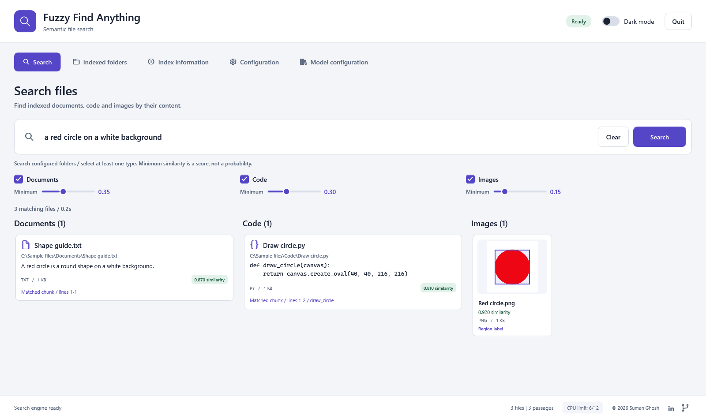
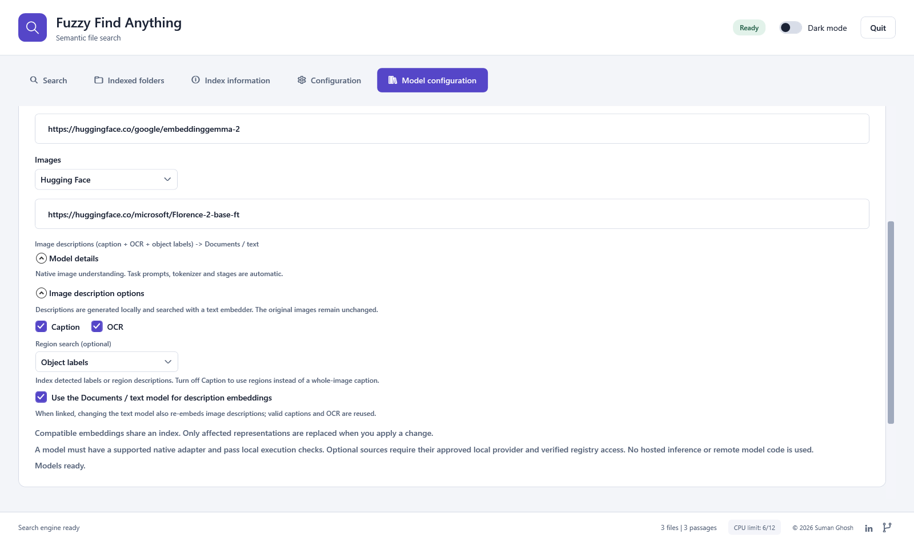

# FuzzyFindAnything 2.0

**Find documents, source code and images by meaning, on your Windows PC.**

[](https://github.com/sumanthewhiz/FuzzyFindAnything/actions/workflows/build.yml?query=branch%3Adev)


[Quickstart](QUICKSTART.md) · [Downloads](QUICKSTART.md#1-download-and-extract) · [Model compatibility](docs/MODEL-COMPATIBILITY.md) · [Documentation](#documentation-and-support) · [Contributing](CONTRIBUTING.md)

FuzzyFindAnything is a native Windows desktop application for finding files when you remember their contents rather than their names. Describe a topic, code behavior or image in natural language, search your local index, and open a match in its usual Windows application.

Search and inference run locally. On first launch, the app downloads and verifies the public EmbeddingGemma2 ONNX model for documents, code and images. No Python, Node.js, development SDK or manual model conversion is required. Model weights remain separate from the application package and retain their upstream terms.

**Author:** [Suman Ghosh](https://github.com/sumanthewhiz) · **Version:** 2.0.0 · **Application license:** [MIT](LICENSE)

## Get started

1. Download `FuzzyFindAnything-v2.0.0-win-x64.zip` for Intel/AMD or `FuzzyFindAnything-v2.0.0-win-arm64.zip` for Windows on ARM. See [download and checksum instructions](QUICKSTART.md#1-download-and-extract).
2. Extract the complete ZIP once and open **FuzzyFindAnything.exe**. Wait for automatic model preparation to finish.
3. Add a folder under **Indexed folders**, then enter a phrase in **Search**.

The application starts with no indexed folders. You control its scope; removing a folder from the index never deletes the original files. Existing installations should follow [Migration and rollback](docs/MIGRATION.md) before replacing binaries.

## What it provides

| Capability | Experience |
|---|---|
| Semantic file search | Separate document, code and image results, with independent similarity thresholds |
| Searchable source context | Content-aware chunks, code symbols and line ranges, and full matched-chunk previews |
| Image search | Direct visual embeddings or caption, OCR, object and region descriptions; clickable image galleries |
| Continuous indexing | Background change tracking, restart reconciliation and durable passage-level progress |
| Configurable models | Independent supported models per content type, automatic acquisition and local device qualification |
| Resource-aware execution | Shared CPU limits and coordinated model memory without discarding the index |
| Native desktop controls | Maximized startup, light/dark appearance, live index statistics, configurable logs and system-tray operation |

### Supported content

| Content | Formats |
|---|---|
| Documents | `.txt`, `.rtf`, `.pdf`, `.doc`, `.docx`, `.ppt`, `.pptx`, `.xls`, `.xlsx` |
| Images | `.jpg`, `.jpeg`, `.png`, `.gif`, `.bmp`, `.ico` |
| Source code | Python, JavaScript/TypeScript, Java, C/C++, Go, Rust, SQL, Bash, C#, PHP, Ruby, Swift, Kotlin and R |

Text and code are read directly; source code is never executed. Other document formats use installed Windows Search IFilters. PDF/Office coverage depends on the matching x64 filters available on the PC. See [supported formats and extraction limits](docs/ARCHITECTURE.md#supported-content).

## Desktop experience

<picture>
  <source media="(prefers-color-scheme: dark)" srcset="docs/images/search-dark.png">
  
</picture>

*Application layout rendered with synthetic demonstration data.*

<details>
<summary>Model configuration and image-region controls</summary>

<picture>
  <source media="(prefers-color-scheme: dark)" srcset="docs/images/models-images-expanded-dark.png">
  
</picture>

</details>

| Tab | Purpose |
|---|---|
| **Search** | Enter a phrase, choose content types, adjust similarity and open results |
| **Indexed folders** | Manage folder scope and review indexing progress or errors |
| **Index information** | View live file counts, index location, size and refresh time |
| **Configuration** | Control logging and its destination |
| **Model configuration** | Select models and inspect their preparation, indexes and execution devices |

Minimize, Close and Alt+F4 hide the window in the **system tray** while indexing continues. The tray icon restores it maximized. Use **Quit** in the window or tray menu to stop the application. No service or automatic sign-in startup is installed.

## Models and architecture

The default is the pinned public [`onnx-community/embeddinggemma-2-ONNX`](https://huggingface.co/onnx-community/embeddinggemma-2-ONNX) package. Verified assets are stored in the writable application-data cache and can be reused offline. Supported alternatives include Qwen, E5, compatible BERT/CLIP exports and the reviewed Florence image-description models. See the [November 2026 compatibility reference](docs/MODEL-COMPATIBILITY.md) for exact URLs, roles, limits and qualification levels.

Model changes are validated before settings and routes are committed. A changed vector contract reindexes only its dependent content; a failed preparation retains the applied selection. GPU/NPU eligibility depends on the exact model, hardware and successful execution checks. The optional [Microsoft provider](QUICKSTART.md#microsoft-employees-psapi-models) requires separate authorized access and is not included in public packages.

The WPF/.NET interface supervises a local indexing coordinator, isolated IFilter extraction and native inference workers. SQLite stores authoritative metadata, vectors and resumable jobs. Microsoft DiskANN provides an in-memory approximate-nearest-neighbor graph with persistent, rebuildable snapshots; it is not an out-of-core index.

The ARM64 package runs the UI and inference natively, with x64 coordinator, DiskANN, extractor and utility processes. The x64 package uses x64 throughout. Each process loads architecture-matched libraries.

For implementation details, see [Architecture](docs/ARCHITECTURE.md) and [Content chunking](docs/CHUNKING.md).

## Requirements and limits

| Requirement | Details |
|---|---|
| Operating system | Windows 11 x64, or ARM64 with compatible AVX2-capable x64 emulation |
| CPU | At least two physical cores; the application and workers share at most half the physical cores |
| Memory | At least 5 GiB available for the default model: a 3 GiB allowance plus a 2 GiB system reserve; allow additional memory for the index and other applications |
| Storage | Allow 5 GB for application files, model downloads and extraction, plus index space |
| Document filters | Compatible installed x64 Office/PDF IFilters; not bundled |
| Network | Required for uncached model downloads and optional authenticated provider discovery, not ordinary local search |

Larger models have separate allowances; download size is not peak RAM. Scanned PDFs require an OCR-capable filter, protected documents are not decrypted, and online-only files must first be made available locally. Junctions and symbolic links are not traversed. Some Excel filters omit inline-string cells. Classified errors and partial results are visible rather than replaced with placeholder embeddings.

## Privacy and operational safety

The app reads configured source files without moving, modifying or deleting them. File content and search queries are not sent to model registries. The local index contains paths, snippets, generated descriptions and embeddings; logs can contain filenames and errors. Protect the data directory with Windows permissions and device encryption.

Process isolation contains faults but is not a security sandbox. Installed filters, execution providers and registered viewers remain part of the machine's trust boundary. See [Security](SECURITY.md) for reporting and handling guidance.

## Build from source

Source builds require PowerShell 7, the .NET 10 SDK, Git, and Visual Studio with Desktop development with C++, CMake and a Windows SDK. The repository pins .NET 10 SDK selection. See [Contributing](CONTRIBUTING.md) for the complete environment and checks.

```powershell
git clone https://github.com/sumanthewhiz/FuzzyFindAnything.git
Set-Location .\FuzzyFindAnything
git switch dev
.\Setup.ps1 -SkipModel
.\Build.ps1 -SkipSetup
```

The application is published under `artifacts\FuzzyFindAnything`. Build different runtime identifiers sequentially. Release packaging and publication requirements are documented in [Validation and releases](docs/VALIDATION.md).

## Documentation and support

| Reference | Contents |
|---|---|
| [Quickstart](QUICKSTART.md) | Download, first launch, indexing, daily use and troubleshooting |
| [Model compatibility](docs/MODEL-COMPATIBILITY.md) | Exact model URLs, supported roles, limits and upstream terms |
| [Architecture](docs/ARCHITECTURE.md) | Process boundaries, inference, persistence, monitoring and operations |
| [Content chunking](docs/CHUNKING.md) | Document/code boundaries, token budgets and matched-source provenance |
| [Migration and rollback](docs/MIGRATION.md) | Preserve folders, settings, vectors and queued work during upgrades |
| [Validation and releases](docs/VALIDATION.md) | Test commands, release gates, packages and checksums |
| [Licensing and model terms](THIRD-PARTY-NOTICES.md) | Application and third-party license boundaries |
| [Contributing](CONTRIBUTING.md) / [Security](SECURITY.md) | Contribution process and private vulnerability reporting |

For product issues, use the [issue tracker](https://github.com/sumanthewhiz/FuzzyFindAnything/issues) and include the version, architecture and a minimal synthetic example. Do not upload private documents, unredacted logs, credentials or catalogs.

## Licensing and attribution

Copyright (c) 2026 **Suman Ghosh**. Original application source and documentation are licensed under [MIT](LICENSE). Dependencies, models and optional SDKs retain their own licenses and terms; see [Third-party notices](THIRD-PARTY-NOTICES.md).

Packages are currently unsigned. SHA-256 checksums verify downloaded bytes, not publisher identity or code signing.

[LinkedIn](https://www.linkedin.com/in/ghoshsuman/) · [GitHub](https://github.com/sumanthewhiz)
