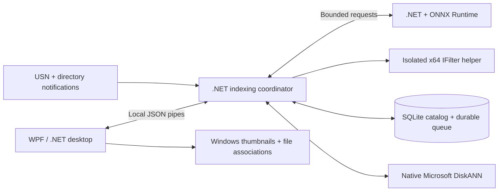

# Fuzzy Find Anything

**Find documents, source code and images by meaning, on your Windows PC.**

[](https://github.com/sumanthewhiz/FuzzyFindAnything/actions/workflows/build.yml)


[**Quickstart**](QUICKSTART.md) ·
[**Native builds**](https://github.com/sumanthewhiz/FuzzyFindAnything/actions/workflows/build.yml?query=branch%3Adev) ·
[Architecture](docs/ARCHITECTURE.md) ·
[Upgrade and rollback](docs/MIGRATION.md) ·
[Report an issue](https://github.com/sumanthewhiz/FuzzyFindAnything/issues)

Fuzzy Find Anything is a native WPF desktop application for finding files when you remember their contents rather than their names. Describe a topic, code behavior or image in natural language, search a persistent local vector index, and open matches in their registered Windows applications.

**The `dev` line is Python-free.** The UI, coordinator, inference host, document helper, acquisition tools and tests use .NET and native Windows libraries. EmbeddingGemma 2 runs through ONNX Runtime; Microsoft DiskANN provides vector search through a native C ABI. There is no interpreter, embedded Python runtime or Python bootstrap step.

> The published **v1.0.0** release is the earlier Python-backed application and is unchanged. Use a native `dev` build or a release explicitly identified as **1.1.0 or later**. Native ONNX model assets are a separate download; see the [model provisioning instructions](QUICKSTART.md#2-provision-the-native-model).

## What it provides

| Capability | Behavior |
|---|---|
| Semantic retrieval | Documents, code and images share the exact EmbeddingGemma 2 embedding space |
| Three result sections | Openable document and code lists, plus a clickable image thumbnail gallery |
| Explicit indexing scope | Select folders and ordinary subfolders; removing scope never deletes source files |
| Background updates | NTFS/ReFS USN replay, directory notifications, and conservative reconciliation |
| Parallel indexing | Independent file pipelines and bounded cross-file inference batches |
| Enforced CPU ceiling | The entire process tree shares at most half the physical cores, even when other cores are idle |
| Durable progress | Completed files and committed passage batches survive crashes and normal exits |
| Startup visibility | Sequenced percentage/phase checkpoints; the first ready model enables search |
| Live index information | Backend/version, location, size, file/document/code/image counts and refresh time |
| Polished desktop controls | Light/dark appearance, persisted similarity, search clearing, configurable logs and keyboard access |

### Supported content

| Category | Formats |
|---|---|
| Documents | `.txt`, `.rtf`, `.pdf`, `.doc`, `.docx`, `.ppt`, `.pptx`, `.xls`, `.xlsx` |
| Images | `.jpg`, `.jpeg`, `.png`, `.gif`, `.bmp`, `.ico` |
| Source code | Python, JavaScript/TypeScript, Java, C/C++, Go, Rust, SQL, Bash, C#, PHP, Ruby, Swift, Kotlin and R |

Text and code are read directly; source code is **never executed**. Other document formats use installed Windows/Office/PDF IFilters, including registered and Office Click-to-Run filters. Images use the model's vision encoder, not filename-derived substitutes. See [format details and limitations](docs/ARCHITECTURE.md#supported-content).

## Get started

1. Download a native package matching your PC, and extract the **complete** ZIP.
2. Acquire the approved, pre-exported ONNX model bundle with the included `Get-Model.ps1`.
3. Open `FuzzyFindAnything.exe`, add a small folder, and try a natural-language search.

A release includes .NET, ONNX Runtime, SQLite, DiskANN and architecture-matched app-local C++ runtimes. Recipients do not need an SDK, Python, pip, Git or Visual Studio. Model assets occupy approximately **1.8 GB uncompressed** and are intentionally separate from the application.

The [quickstart](QUICKSTART.md) includes exact download, verification, model and first-search steps. Existing users should read the [migration runbook](docs/MIGRATION.md) before switching deployments.

## Desktop experience

<picture>
  <source media="(prefers-color-scheme: dark)" srcset="docs/images/search-dark.png">
  
</picture>

*The actual application layout, rendered with synthetic demonstration data.*

| Tab | Purpose |
|---|---|
| **Search** | Enter a phrase; inspect document, code and image matches; adjust saved similarity; clear results |
| **Indexed folders** | Add roots, review concise succeeded/failed counts, and remove checked folders |
| **Index information** | Inspect continuously refreshed index metadata |
| **Configuration** | Enable/disable logging and choose its destination |

The window opens maximized. Closing it minimizes it to the taskbar while indexing continues; **Quit** stops the application. It does not install a service or register automatic startup at sign-in.

## Architecture



The ARM64 package uses **native ARM64 UI and inference**, with an **x64 coordinator, DiskANN and IFilter helper**. The current C++ DiskANN/MKL implementation requires this deliberate process boundary; no mixed-architecture DLLs are loaded into one process. The x64 package uses x64 throughout.

The active mutable DiskANN graph resides in memory and is checkpointed to disk. SQLite retains vectors, folder ownership, source revisions and passage progress so a damaged or stale graph can recover without repeating committed inference. It is not an out-of-core index.

On a 12-core PC, six file pipelines can overlap reading, extraction and preparation even when only one model fits in memory. Text requests coalesce into batches of up to eight passages; up to two images are scheduled together using separate, valid single-image vision calls. The status display distinguishes file workers, model processes, compute threads and batch size. Eligible cores are a ceiling, not a promise of constant CPU utilization.

## Privacy and operational safety

- Inference and search run locally. Source files and queries are not sent to model services.
- Only configured folders define indexing scope. Source content is read, not moved, edited or deleted.
- Interrupted work resumes at the last durable passage commit. An interrupted, uncommitted native operation may run again.
- Repeated notifications and parent-directory changes do not restart unchanged jobs.
- Content errors, unavailable dependencies and temporary failures have explicit diagnostics and retry policies.
- The index contains paths, snippets and embeddings; logs contain paths and error details. Protect both with Windows permissions and disk encryption.

Process isolation is fault containment, not a security sandbox. Installed IFilters and registered viewers remain part of the machine's trust boundary.

## Build from source

Use **PowerShell 7**, Windows 11, the **.NET 10 SDK**, Git and Visual Studio 2022 or later with **Desktop development with C++**, CMake and a Windows SDK. ARM64 packages also need the ARM64 C++ redistributable files supplied with the corresponding MSVC tools.

```powershell
git clone --branch dev https://github.com/sumanthewhiz/FuzzyFindAnything.git
Set-Location .\FuzzyFindAnything
.\Setup.ps1 -SkipModel
.\Get-Model.ps1 -SourceDirectory 'D:\ApprovedModels\embeddinggemma-2-onnx-v1'
.\Build.ps1 -SkipSetup
& .\artifacts\FuzzyFindAnything\FuzzyFindAnything.exe
```

Setup builds the pinned DiskANN source and native utilities; NuGet restores managed dependencies. No global interpreter environment is installed or modified. Models, downloads, build output and personal data are excluded from Git.

### Verification and distribution

```powershell
.\tests\RunChecks.ps1
.\Build-Release.ps1 -SkipSetup -RuntimeIdentifier win-x64
.\Build-Release.ps1 -SkipSetup -RuntimeIdentifier win-arm64
```

The [build workflow](.github/workflows/build.yml) produces self-contained architecture-specific ZIPs and SHA-256 sidecars. Release verification checks the complete file inventory, architecture boundaries, relative runtime paths, model/user-data exclusion, and absence of interpreter payloads. Relocated native smoke tests run with Python absent from `PATH`.

Pull requests and branch builds produce temporary Actions artifacts. A matching version tag publishes release downloads; a `dev` push does not modify `main` or publish a stable release. Model bundles are prepared separately and are **not automatically uploaded**.

Packages are unsigned. Checksums detect altered downloads but do not replace code signing or publisher verification.

## Requirements and limits

- Windows 11, at least two physical cores, and an AVX2-capable x64 CPU or Windows ARM64 with compatible x64 emulation.
- At least **5 GiB available RAM** for one model; approximately **8 GiB available** permits two. These are planning estimates, not quotas. Large indexes need additional memory; 16 GB system RAM or more is recommended.
- Scanned PDFs need an OCR-capable installed IFilter. Protected documents are not decrypted.
- Online-only files must be available locally. Junctions and symbolic links are not traversed.
- Installed filters determine document coverage. Some Excel filters omit inline-string cells in otherwise valid workbooks.
- Large workbooks and image collections remain compute-intensive. All distinct supported passages are processed; content is not silently sampled.

## Documentation and support

| Reference | Contents |
|---|---|
| [Quickstart](QUICKSTART.md) | Packages, native model provisioning and a first search |
| [Architecture and operations](docs/ARCHITECTURE.md) | Process boundaries, model contract, queue, monitoring, settings, logs and maintenance |
| [Migration and rollback](docs/MIGRATION.md) | Preserving existing scope, vectors, queued work and preferences |
| [Validation](docs/VALIDATION.md) | Acceptance commands, evidence and reproducible test coverage |

For issues, include the version, Windows/CPU architecture and relevant error text. **Do not upload private documents, unredacted logs, credentials or your catalog.**

## Licensing and attribution

Copyright © 2026 **Suman Ghosh**.

An open-source license for the application's own source has not been designated. Dependency licenses do not license the application. Packages retain component notices and a versioned inventory. EmbeddingGemma 2 and its model card/terms are acquired separately; Office/PDF filters are not redistributed.

[LinkedIn](https://www.linkedin.com/in/ghoshsuman/) · [GitHub](https://github.com/sumanthewhiz)
