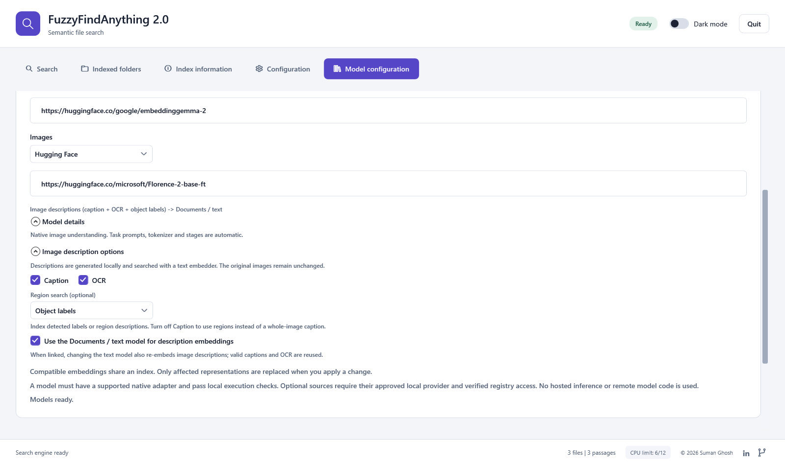
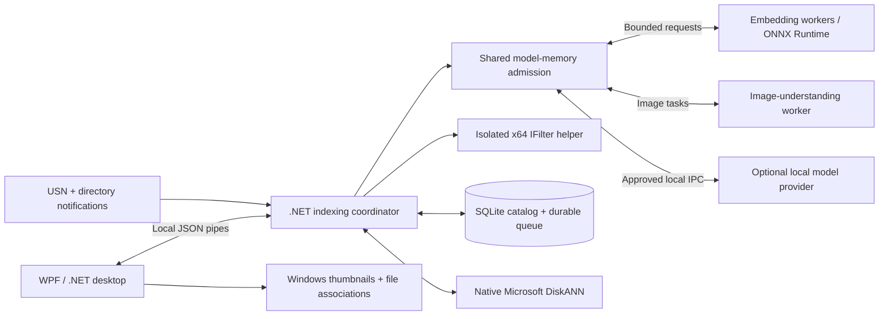

# FuzzyFindAnything 2.0

**Find documents, source code and images by meaning, on your Windows PC.**

**Author: Suman Ghosh** · **Application license: [MIT](LICENSE)** · **Version: 2.0.0**

[](https://github.com/sumanthewhiz/FuzzyFindAnything/actions/workflows/build.yml)


[**Quickstart**](QUICKSTART.md) ·
[**Download binaries**](QUICKSTART.md#1-download-the-right-package) ·
[Architecture](docs/ARCHITECTURE.md) ·
[Chunking](docs/CHUNKING.md) ·
[Upgrade and rollback](docs/MIGRATION.md) ·
[Licenses and model terms](THIRD-PARTY-NOTICES.md) ·
[Contributing](CONTRIBUTING.md) ·
[Report an issue](https://github.com/sumanthewhiz/FuzzyFindAnything/issues)

FuzzyFindAnything 2.0 is a native WPF desktop application for finding files when you remember their contents rather than their names. Describe a topic, code behavior or image in natural language, search a persistent local vector index, and open matches in their registered Windows applications.

Search and inference run locally. The application uses .NET/native Windows libraries, ONNX Runtime and Microsoft DiskANN; normal setup and runtime do not require Python. Model assets are acquired separately under their upstream terms. The [binary-first quickstart](QUICKSTART.md) includes a public-model setup that needs no source build or private model bundle.

The repository, executable and persistent data-directory names remain **`FuzzyFindAnything`**. The 2.0 suffix is app branding, not a data migration.

## What it provides

| Capability | Behavior |
|---|---|
| Semantic retrieval | EmbeddingGemma 2 is the default; compatible document spaces share indexes while query roles remain explicit |
| Three result sections | Openable document and code lists, plus a clickable image thumbnail gallery |
| Per-type search | Select documents, code and/or images with independent saved similarity thresholds; at least one type stays selected |
| Content-aware chunks | Document sections/paragraphs and native syntax-aware code units, with model-token limits and source provenance |
| Matched-chunk previews | Hover at the bottom of a document/code match to inspect the actual retained chunk and source location |
| Explicit indexing scope | Select folders and ordinary subfolders; removing scope never deletes source files |
| Background updates | NTFS/ReFS USN replay, directory notifications, and conservative reconciliation |
| Changes while the app is closed | Background timestamp/size/identity checks on restart update only added, changed or deleted files |
| Parallel indexing | Independent file pipelines and bounded cross-file inference batches |
| Enforced CPU ceiling | The entire process tree shares at most half the physical cores, even when other cores are idle |
| Durable progress | Completed files and committed passage batches survive crashes and normal exits |
| Startup visibility | Sequenced percentage/phase checkpoints; optional extra-worker warmup does not delay search |
| Memory-aware workers | Idle model processes can be unloaded and reloaded on demand, without removing indexes or weakening the system reserve |
| Live index information | Backend/version, location, size, file/document/code/image counts and refresh time |
| Model configuration | Independent Hugging Face or approved Microsoft sources per file type; automatic model-specific preparation and conditional controls |
| Internal Microsoft models | A separately installed provider supplies version-aware fixed model choices, native tokenization and actual local device qualification; private payloads are not bundled |
| Image understanding | Reviewed caption/OCR providers feed a linked or separate text embedder; completed generation stages are durable and reusable |
| Regional image search | Qualified detectors/describers embed each region's text; gallery matches identify and highlight the best matching region |
| Polished desktop controls | Light/dark appearance, persisted similarity, search clearing, configurable logs and keyboard access |

### Supported content

| Category | Formats |
|---|---|
| Documents | `.txt`, `.rtf`, `.pdf`, `.doc`, `.docx`, `.ppt`, `.pptx`, `.xls`, `.xlsx` |
| Images | `.jpg`, `.jpeg`, `.png`, `.gif`, `.bmp`, `.ico` |
| Source code | Python, JavaScript/TypeScript, Java, C/C++, Go, Rust, SQL, Bash, C#, PHP, Ruby, Swift, Kotlin and R |

Text and code are read directly; source code is **never executed**. Other document formats use installed Windows/Office/PDF IFilters, including registered and Office Click-to-Run filters. Images use direct visual embeddings or a reviewed image-to-text-to-embedding pipeline, never filename substitutes for failed inference. See [format details and limitations](docs/ARCHITECTURE.md#supported-content).

## Get started

1. Download a native package matching your PC, and extract the **complete** ZIP.
2. Follow **[Prepare models](QUICKSTART.md#2-prepare-models)**: use the public MiniLM/CLIP starter configuration or provision the approved EmbeddingGemma2 native bundle.
3. Open `FuzzyFindAnything.exe`, add a small folder, and try a natural-language search.

A binary package includes .NET, ONNX Runtime, Windows ML, SQLite, DiskANN and architecture-matched app-local C++ runtimes. Ordinary Hugging Face users do not need an SDK, Python, pip, Git or Visual Studio. Models are intentionally separate; their size and memory needs depend on the selection. The default native EmbeddingGemma2 bundle is approximately **1.8 GB uncompressed**. Optional Microsoft models have additional authentication prerequisites described in the [employee quickstart](QUICKSTART.md#microsoft-employees-psapi-models).

The [quickstart](QUICKSTART.md) includes exact download, verification, model and first-search steps. Existing users should read the [migration runbook](docs/MIGRATION.md) before switching deployments.

## Desktop experience

<picture>
  <source media="(prefers-color-scheme: dark)" srcset="docs/images/search-dark.png">
  
</picture>

*The actual application layout, rendered with synthetic demonstration data.*

<details>
<summary>Model configuration and image-region controls</summary>

<picture>
  <source media="(prefers-color-scheme: dark)" srcset="docs/images/models-images-expanded-dark.png">
  
</picture>

</details>

| Tab | Purpose |
|---|---|
| **Search** | Enter a phrase; inspect document, code and image matches; adjust saved similarity; clear results |
| **Indexed folders** | Add roots, review concise succeeded/failed counts, and remove checked folders |
| **Index information** | Inspect continuously refreshed index metadata |
| **Configuration** | Enable/disable logging and choose its destination |
| **Model configuration** | Apply compatible local embedding models and inspect their indexes and execution devices |

The window opens maximized. Minimizing or closing it hides it in the **system tray** while indexing continues, without leaving a taskbar button. Click the tray icon or choose **Open FuzzyFindAnything 2.0** to restore the window; **Quit** in either the window or tray menu stops the application. Windows may place the icon in the notification-area overflow menu. The app does not install a service or register automatic startup at sign-in.

## Tech stack and architecture layers

| Layer | Technology | Responsibility |
|---|---|---|
| Desktop experience | C#, .NET 10, WPF, Windows shell | Search, folder scope, settings, thumbnails, file opening and tray lifecycle |
| Coordination | .NET, supervised JSON-line process IPC | Durable work scheduling, model changes, resource admission and recovery |
| Content preparation | Windows IFilters, native image decoding, Tree-sitter 1.3.0 | Text extraction, document/code boundaries, image orientation and provenance |
| Local inference | ONNX Runtime 1.31.0, Windows ML 2.4.89, native tokenizers | Reviewed embedding and image-understanding recipes; real CPU/GPU/NPU checks |
| Persistence and retrieval | SQLite, DiskANN 0.7.0 through a C++ bridge | Authoritative metadata/vectors, resumable jobs and rebuildable ANN snapshots |
| Change tracking | USN journal, directory notifications, reconciliation | Incremental indexing, restart deltas and stale-source detection |

The optional Microsoft companion adds another supervised local inference process; it is not a cloud inference service or part of the public binary payload.



The ARM64 package uses **native ARM64 UI and inference**, with an **x64 coordinator, DiskANN and IFilter helper**. The current C++ DiskANN/MKL implementation requires this deliberate process boundary; no mixed-architecture DLLs are loaded into one process. The x64 package uses x64 throughout.

### Chunking and retrieval

The app chooses chunks; the embedding model does not split files. Documents use available headings, paragraphs and sentence boundaries. Code uses native syntax/declaration units with explicit line-aware fallbacks. The selected model's tokenizer measures every chunk against its input budget. Boundaries, overlap, source lines and symbols remain associated with the stored vector and matched-chunk preview. See [the chunking strategy](docs/CHUNKING.md).

Direct image embeddings do not use document/code chunks. Caption/OCR/region pipelines first produce text, retain that generation artifact, then embed the text. Region search matches labeled region text and returns the original image with the best matching box, not a separate crop-vector index.

### Model choices

EmbeddingGemma2 is the built-in default for every file type; the optional public starter configuration uses MiniLM/CLIP instead. Tokenizer and pipeline settings are resolved automatically. The **Model configuration** tab resolves reviewed native recipes for text/code embeddings and retains direct CLIP image support. Query instructions, tokenization, pooling, tensor interfaces and device qualification are part of the recipe, not arbitrary downloaded model code. Unsupported families, missing exports, text-only image assignments and unusable device profiles are rejected before an index is changed.

Examples include `Qwen/Qwen3-Embedding-0.6B`, `intfloat/e5-base-v2`, `vectoriseai/e5-small-v2`, the existing MiniLM examples and `Xenova/clip-vit-base-patch32`. The Qwen card resolves to a pinned stateless Qdrant ONNX export; the UI discloses the actual artifact source. Qwen Coder generation models are not interchangeable with text embedding checkpoints.

For image understanding, `microsoft/Florence-2-base-ft`, `microsoft/Florence-2-base`, `microsoft/Florence-2-large-ft` and `microsoft/Florence-2-large` use the reusable native encoder-decoder recipe. Captions, optional OCR and optional **Object labels** (`<OD>`) or **Region descriptions** (`<DENSE_REGION_CAPTION>`) feed the selected text embedder. Region-only indexing is also supported. Each region's label/description is embedded separately; the gallery returns the original image once, with its best matching region highlighted and the matching text available on hover.

The image recipe resolves its tokenizer, processor, graph bindings and task prompts automatically. Region controls appear only for a qualifying image model; direct Gemma/CLIP embeddings do not acquire a generation pipeline. Other compatible checkpoints can use reviewed recipe data; different architectures or output formats still require a native adapter/postprocessor and qualification. This is not unrestricted support for every vision model, and generated labels are not verified facts or confidence scores.

The compatible-model host uses self-contained Windows ML to discover usable CPU, GPU and NPU execution providers. Acceptance depends on hardware, driver/provider, resource limits and real inference, not a blanket accelerator restriction. Query-only changes retain file embeddings; accepted document-model changes rebuild only affected file types. See [model configuration and device checks](docs/ARCHITECTURE.md#configurable-models-and-device-checks).

When live authenticated registry access succeeds, each role can instead select **Microsoft**. The model picker includes available CPU, NPU or GPU variants directly; version controls offer compatible drops rather than unsupported placeholders. Without verified access, only Hugging Face is offered. Saved provider bindings are retained, not silently changed when connectivity is lost. Native query/document purposes and matching tokenizers are automatic, and direct image embeddings do not expose caption/region-generation controls. Apply still runs real native execution checks.

The optional companion is maintained in the [private source repository](https://github.com/sumghosh_microsoft/FuzzyFindAnything-MicrosoftProvider), not in the public source or application ZIPs. Microsoft GitHub enterprise members can use the [internal employee download channel](https://github.com/experiences-and-devices/APT/releases/tag/ffa-microsoft-provider-v1.5.0-internal.3) without an invitation to the personal repository. **Refresh model sources** acquires the pinned architecture-specific companion release using an installed GitHub CLI signed in with an authorized work account. The app verifies the internal repository identity/visibility, exact companion release, archive checksums, file inventory and binary architecture before registering it under `%LOCALAPPDATA%\FuzzyFindAnythingProviders`. Credentials are not bundled. Registry access is checked separately before offering Microsoft models. An installed companion does not require GitHub sign-in for routine local inference.

The active mutable DiskANN graph resides in memory and is checkpointed to disk. SQLite retains vectors, folder ownership, source revisions and passage progress so a damaged or stale graph can recover without repeating committed inference. It is not an out-of-core index.

On a 12-core PC, six file pipelines can overlap reading, extraction and preparation even when only one model fits in memory. Text requests coalesce into batches of up to eight passages; up to two images are scheduled together using separate, valid single-image vision calls. The status display distinguishes file workers, model processes, compute threads and batch size. Eligible cores are a ceiling, not a promise of constant CPU utilization.

Model loading is coordinated across embedding workers, image generation and provider validation. When memory is tight, the engine drains active operations and releases idle workers before loading another model; an evicted worker reloads when needed. Indexes and cached image descriptions remain intact. A failed or cancelled model change leaves the previous configuration usable. Genuine insufficient-memory errors still report the model allowance, available RAM and unchanged 2 GiB system reserve.

## Privacy and operational safety

- Inference and search run locally. Source files and queries are not sent to model services.
- Only configured folders define indexing scope. Source content is read, not moved, edited or deleted.
- Interrupted work resumes at the last durable passage commit. An interrupted, uncommitted native operation may run again.
- Repeated notifications and parent-directory changes do not restart unchanged jobs.
- Every restart checks configured folders and subfolders in the background for changes made while the app was stopped. Search becomes available when the model is ready, without waiting for that check or the incremental indexing queue.
- Content errors, unavailable dependencies and temporary failures have explicit diagnostics and retry policies.
- The index contains paths, snippets and embeddings; logs contain paths and error details. Protect both with Windows permissions and disk encryption.

Process isolation is fault containment, not a security sandbox. Installed IFilters and registered viewers remain part of the machine's trust boundary.

## Build from source

Use **PowerShell 7**, Windows 11, the **.NET 10 SDK**, Git and Visual Studio 2022 or later with **Desktop development with C++**, CMake and a Windows SDK. ARM64 packages also need the ARM64 C++ redistributable files supplied with the corresponding MSVC tools.

```powershell
git clone https://github.com/sumanthewhiz/FuzzyFindAnything.git
Set-Location .\FuzzyFindAnything
.\Setup.ps1 -SkipModel
.\Build.ps1 -SkipSetup
```

Setup builds the pinned DiskANN source and native utilities; NuGet restores managed dependencies. Then use the [quickstart](QUICKSTART.md#2-prepare-models) from `artifacts\FuzzyFindAnything`. No global interpreter environment is installed or modified. Models, downloads, build output and personal data are excluded from Git. Contributor requirements and focused test guidance are in [CONTRIBUTING.md](CONTRIBUTING.md).

### Verification and distribution

```powershell
.\tests\RunChecks.ps1
.\Build-Release.ps1 -SkipSetup -RuntimeIdentifier win-x64
.\Build-Release.ps1 -SkipSetup -RuntimeIdentifier win-arm64
```

The [build workflow](.github/workflows/build.yml) produces self-contained architecture-specific ZIPs and SHA-256 sidecars. Release verification checks the complete file inventory, architecture boundaries, relative runtime paths, model/user-data exclusion, and absence of interpreter payloads. Relocated native smoke tests run with Python absent from `PATH`.

Pull requests and branch builds produce downloadable Actions artifacts. Tagged releases additionally require the approved model-parity source configured by the maintainer. Model bundles are prepared separately and are **not automatically uploaded**. Download a package matching 2.0.0, not an older release or GitHub's source-code ZIP.

Packages are unsigned. Checksums detect altered downloads but do not replace code signing or publisher verification.

## Requirements and limits

- Windows 11, at least two physical cores, and an AVX2-capable x64 CPU or Windows ARM64 with compatible x64 emulation.
- At least **5 GiB available RAM** for the default model; approximately **8 GiB available** permits its optional second copy. These are planning estimates, not quotas. Large indexes need additional memory; 16 GB system RAM or more is recommended.
- Florence-2 Large profiles require approximately **3.07 GiB of downloaded graph assets** and a **6.5 GiB generator memory allowance plus 2 GiB system reserve**. Idle embedders can be unloaded to make room; keeping both resident requires additional memory. Admission is checked before loading; download size is not peak RAM.
- Scanned PDFs need an OCR-capable installed IFilter. Protected documents are not decrypted.
- Online-only files must be available locally. Junctions and symbolic links are not traversed.
- Installed filters determine document coverage. Some Excel filters omit inline-string cells in otherwise valid workbooks.
- Large workbooks and image collections remain compute-intensive. All distinct supported passages are processed; content is not silently sampled.

## Documentation and support

| Reference | Contents |
|---|---|
| [Quickstart](QUICKSTART.md) | Packages, native model provisioning and a first search |
| [Architecture and operations](docs/ARCHITECTURE.md) | Process boundaries, model contract, queue, monitoring, settings, logs and maintenance |
| [Migration and rollback](docs/MIGRATION.md) | Preserving existing scope, vectors, queued work and preferences |
| [Validation](docs/VALIDATION.md) | Acceptance commands, evidence and reproducible test coverage |
| [Licenses and model terms](THIRD-PARTY-NOTICES.md) | MIT application scope, dependency notices and upstream artifact terms |
| [Contributing](CONTRIBUTING.md) | Development, tests, compatibility and contribution terms |
| [Security policy](SECURITY.md) | Private reporting, trust boundaries and sensitive-data handling |

For issues, include the version, Windows/CPU architecture and relevant error text. **Do not upload private documents, unredacted logs, credentials or your catalog.**

## Licensing and attribution

Copyright © 2026 **Suman Ghosh**.

The application's original source and documentation are licensed under **MIT**; see [LICENSE](LICENSE). Dependencies, native runtimes, SDKs and model artifacts retain their respective licenses. **Models downloaded via Hugging Face are subject to their creators' upstream licenses and terms of use.** The app's MIT grant does not relicense those artifacts or grant access to internal Microsoft components. See [THIRD-PARTY-NOTICES.md](THIRD-PARTY-NOTICES.md) and the original notices included with binary packages.

[LinkedIn](https://www.linkedin.com/in/ghoshsuman/) · [GitHub](https://github.com/sumanthewhiz)
