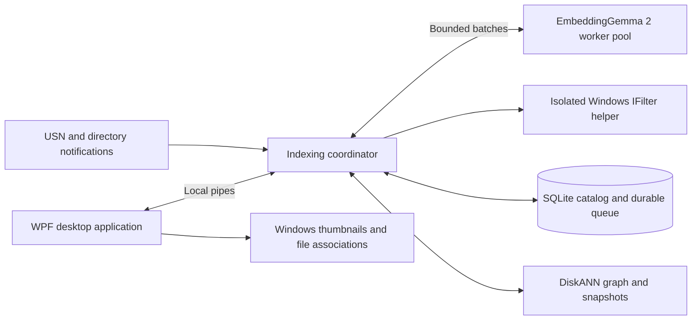

# Fuzzy Find Anything

**Search your documents and images by meaning, entirely on your Windows PC.**

[](https://github.com/sumanthewhiz/FuzzyFindAnything/actions/workflows/build.yml)
[](https://github.com/sumanthewhiz/FuzzyFindAnything/releases/latest)


[**Download for Windows**](https://github.com/sumanthewhiz/FuzzyFindAnything/releases/latest) ·
[**Quickstart**](QUICKSTART.md) ·
[Architecture and operations](docs/ARCHITECTURE.md) ·
[Report an issue](https://github.com/sumanthewhiz/FuzzyFindAnything/issues)

Fuzzy Find Anything is a native WPF desktop application for finding files when you remember their contents, but not their names. Describe a document, subject, or image in natural language; the application searches a persistent local vector index and opens results in your usual Windows applications.

Text and images share the same embedding space through **Google EmbeddingGemma 2**. **Microsoft DiskANN** provides nearest-neighbor search, Windows **IFilters** extract document content, and a durable SQLite catalog keeps indexing progress recoverable.

## Get started

1. Download the **`win-x64.zip`** release for Intel/AMD PCs or **`win-arm64.zip`** for Windows on ARM.
2. Extract the entire archive to a writable local folder.
3. Run the included `Get-Model.ps1`, then open `FuzzyFindAnything.exe` and add a folder.

**No Python installation, .NET runtime, Git, or developer tools are needed for a release download.** The ZIP includes the required application runtimes. Model assets are acquired separately, approximately 1.5 GB plus configuration/tokenizer files.

See the [quickstart](QUICKSTART.md) for exact commands, hardware requirements, model setup, and a first search.

## Capabilities

| Area | What the application provides |
|---|---|
| Semantic search | Natural-language retrieval across document contents and image features, with an adjustable similarity threshold |
| Results | Separate document list and image thumbnail gallery; open any result through its registered Windows viewer |
| Indexing scope | Explicit folder selection, recursive indexing, and safe removal without deleting original files |
| Background updates | USN journal and directory notifications, with periodic reconciliation where needed |
| Parallel processing | Concurrent file/passage work within a hard, shared limit of half the physical CPU cores |
| Durable progress | Persistent file jobs and saved passage batches resume after an exit or interruption |
| Index information | Live file/document/image counts, database size, location, backend version, and refresh timestamp |
| Application settings | Light/dark appearance, XML-persisted preferences, configurable per-file logging, and search clearing |

### Supported formats

| Documents | Images |
|---|---|
| `.txt`, `.rtf`, `.pdf`, `.doc`, `.docx`, `.ppt`, `.pptx`, `.xls`, `.xlsx` | `.jpg`, `.jpeg`, `.png`, `.gif`, `.bmp`, `.ico` |

Plain text is read directly. Other document formats require compatible **installed Windows/Office/PDF IFilters**; the application does not redistribute Office filters. Images use the model's vision encoder rather than filename matching.

## The interface

| Tab | Purpose |
|---|---|
| **Search** | Enter a phrase, inspect document/image matches, adjust similarity, and clear the current search |
| **Indexed folders** | Add roots, review succeeded/failed counts, and remove checked folders |
| **Index information** | Inspect live statistics and local storage details |
| **Configuration** | Enable or disable logging and choose where new logs are written |

The window opens maximized. Closing it minimizes it to the taskbar so indexing can continue; **Quit** stops the application. It does not register itself as a Windows service or automatic sign-in application.

## Privacy and reliability

- **On-device processing.** Documents, images, queries, and embeddings are processed locally. Network access is required for the initial application/model downloads, not normal search.
- **Explicit scope.** Only configured folders are indexed. Removing a root removes its index ownership, not the source files.
- **Recoverable work.** Completed files and committed passage batches survive restarts. A batch interrupted before its commit may be recomputed.
- **Delta updates.** Repeated notifications and directory changes do not restart unchanged files or discard their queued progress.
- **Bounded CPU use.** All workers share one restricted set of physical cores; the limit is not independently multiplied per worker.
- **Visible failures.** Per-file logs distinguish permanent content errors from temporary failures. Logging failures do not erase indexing progress.

The local catalog contains filenames, extracted snippets, and embeddings. Logs can contain paths and error details. Protect these locations with Windows permissions and disk encryption; local inference does not make stored data anonymous.

## Architecture



The UI is native to the selected architecture. The current engine uses a **bundled x64 Python runtime** and isolated inference processes; the application is not yet Python-free internally. On ARM64, the UI runs natively while the engine and extraction helper use Windows x64 compatibility.

The active mutable DiskANN graph resides in memory and is checkpointed to disk. SQLite preserves vectors and work-in-progress so the graph can recover without repeating committed inference.

For process boundaries, queue transactions, model identity, extraction limits, recovery, and maintenance, read [Architecture and operations](docs/ARCHITECTURE.md).

## Build from source

Development requires Windows 11, the **.NET 10 SDK**, PowerShell, and a bootstrap Python installation with pip supporting `--python`.

```powershell
git clone https://github.com/sumanthewhiz/FuzzyFindAnything.git
Set-Location .\FuzzyFindAnything
.\Setup.ps1 -SkipModel
.\Get-Model.ps1
.\Build.ps1 -SkipSetup
& .\artifacts\FuzzyFindAnything\FuzzyFindAnything.exe
```

The model is pinned to a specific revision and is not stored in Git. Dependencies are installed into a private `.runtime` directory, not the developer's global Python environment.

### Release pipeline

[GitHub Actions](https://github.com/sumanthewhiz/FuzzyFindAnything/actions/workflows/build.yml) builds self-contained x64 and ARM64 packages, runs automated regressions, validates release contents, and exercises a relocated runtime.

- **Pull requests and `main`:** build checks and downloadable, short-lived Actions artifacts.
- **Version tags (`v1.0.0`, for example):** the same checks followed by a GitHub Release with ZIPs and SHA-256 checksums.
- **Model files and personal indexes:** never included in release assets.

Packages are currently **unsigned**. Checksums detect a changed download but do not replace code signing or publisher verification. Review the repository/release origin and follow your organization's application policy.

## Requirements and limitations

- Windows 11 x64 or ARM64, at least two physical CPU cores, and several GB of free RAM. For the two-worker configuration, plan for roughly **8 GB of available memory**; large indexes require more.
- CPU inference can take substantial time for large workbooks or image collections. Throughput depends on content, hardware, and memory pressure.
- Scanned PDFs require an OCR-capable installed IFilter. Encrypted documents are not decrypted.
- Online-only files must be made available locally. Symbolic links and junctions are not traversed.
- Format coverage depends on installed filters; universal extraction from every supported extension is not guaranteed.
- The release does not provide a Windows service, cloud index, hosted inference, or automatic startup at sign-in.

## Documentation and support

| Resource | Use it for |
|---|---|
| [Quickstart](QUICKSTART.md) | Download, acquire the model, launch, and try a first search |
| [Architecture and operations](docs/ARCHITECTURE.md) | Design, persistence, configuration, troubleshooting, testing, and maintenance |
| [Issues](https://github.com/sumanthewhiz/FuzzyFindAnything/issues) | Reproducible bugs and feature requests |
| [Releases](https://github.com/sumanthewhiz/FuzzyFindAnything/releases) | Published packages and change history |

When reporting a problem, include the application version, Windows/CPU architecture, and relevant error text. **Do not upload private documents, unredacted logs, credentials, or your index database.**

## Licensing and attribution

Copyright (c) 2026 **Suman Ghosh**.

An open-source license for this application's own source has **not yet been designated**. Public availability does not grant a general license to redistribute or modify it. Third-party components remain under their respective licenses; downloadable packages retain their supplied notices and include `THIRD-PARTY-NOTICES.txt` and a dependency inventory.

EmbeddingGemma 2 is downloaded separately and is subject to its model license. Windows and Office/PDF IFilters are separately installed components.

[LinkedIn](https://www.linkedin.com/in/ghoshsuman/) · [GitHub](https://github.com/sumanthewhiz)
