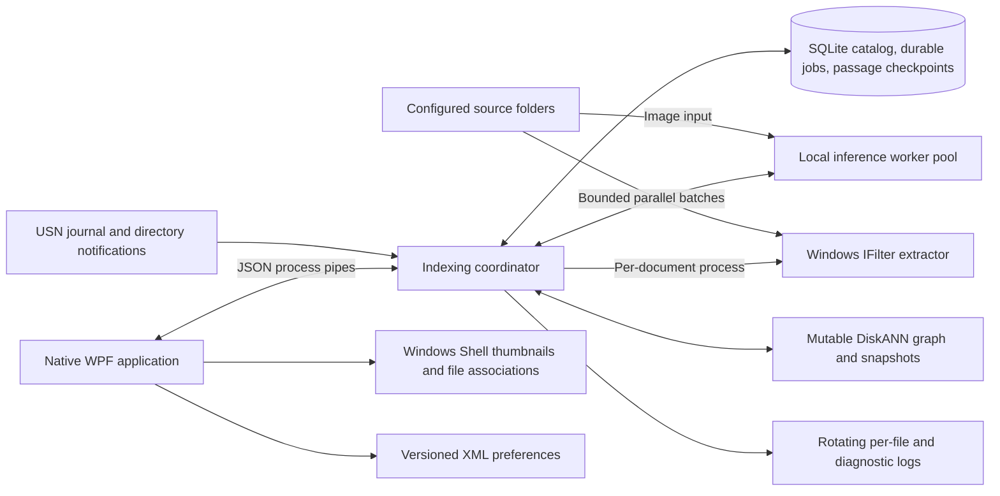

# Architecture and operations

[Project overview](../README.md) | [Download and quickstart](../QUICKSTART.md)

Fuzzy Find Anything is a Windows desktop application for semantic discovery of documents and images across explicitly configured folders. It combines a native WPF interface, local multimodal inference, Windows document filters, and a persistent DiskANN index.

The application is intended for users who know what a file contains but do not remember its name or location. Documents and images share one embedding space, allowing natural-language queries to retrieve both written content and visual material.

## Contents

- [Design objectives and boundaries](#design-objectives-and-boundaries)
- [Platform and prerequisites](#platform-and-prerequisites)
- [Getting started](#getting-started)
- [Model acquisition and lifecycle](#model-acquisition-and-lifecycle)
- [Architecture](#architecture)
- [Indexing and search workflow](#indexing-and-search-workflow)
- [Persistence and recovery](#persistence-and-recovery)
- [Supported content and extraction policy](#supported-content-and-extraction-policy)
- [Operation and maintenance](#operation-and-maintenance)
- [Development and verification](#development-and-verification)
- [Repository policy](#repository-policy)
- [Dependencies and licensing](#dependencies-and-licensing)

## Design objectives and boundaries

| Objective | Implementation |
|---|---|
| Keep content processing local | Text, images, queries, and embeddings are processed on the device. Model inference has no hosted-service dependency. |
| Make indexing scope explicit | The persisted folder list is the authority for crawling, monitoring, ownership, and removal. |
| Preserve original files | Indexing reads source files; removing a folder removes search data, not the original files. |
| Resume interrupted work | SQLite records queued files, prepared passages, completed embedding batches, and published vectors; restart resumes the remaining work. |
| Keep the interface responsive | Inference and extraction run outside the UI process; queries receive priority between document batches. |
| Bound resource consumption | All application workers share an affinity set containing at most half of the physical CPU cores. |
| Make failures actionable | Invalid content, missing filters, temporary I/O failures, and processing limits have distinct diagnostics and retry behavior. |

### Scope

- Four-tab native Windows UI with document results, an image gallery, folder management, live index metadata, and logging configuration.
- Consistent light/dark appearance, persisted preferences, and keyboard-accessible controls.
- Recursive indexing of supported, locally available files in configured folders.
- Incremental updates using the USN journal and directory notifications, supplemented by reconciliation.
- A per-user background application that remains active when its window is dismissed.

### Non-goals

- A Windows service, automatic sign-in agent, or replacement for the Windows Search system catalog.
- A backup, synchronization, document-conversion, or file-management system.
- A hosted vector database, multi-user authorization service, or retrieval-augmented chat interface.
- Automatic decryption of protected documents, universal OCR, or guaranteed extraction from every file carrying a supported extension.
- An out-of-core graph implementation: the active mutable DiskANN graph resides in RAM.

These boundaries are relevant to deployment planning. Process isolation improves fault containment but is not a security sandbox. Local storage is not independently encrypted by the application.

## Platform and prerequisites

| Component | Requirement |
|---|---|
| Operating system | Windows 11 on x64 or ARM64 |
| Build tools | .NET 10 SDK and PowerShell; PowerShell 7 is recommended for setup and publishing |
| Bootstrap Python | An existing Python installation with pip supporting `--python` (pip 22.3 or later) |
| Application Python | Provisioned separately by `Setup.ps1`: private CPython 3.11 x64 under `.runtime` |
| Document extraction | Installed Windows/Office/PDF IFilters compatible with the x64 extractor |
| Model assets | Downloaded separately from Hugging Face; approximately 1.5 GB for the model checkpoint, plus tokenizer and configuration assets |
| Hardware capacity | At least two physical CPU cores; plan for roughly 8 GB of available memory when using two model workers, plus storage for runtime, model, catalog, and snapshots |

The UI is published for the host OS architecture. On ARM64 Windows, the WPF application is native ARM64, while the Python workers and IFilter helper use x64 compatibility. This split follows the architecture supported by the published `diskannpy` Windows package.

The published .NET applications are self-contained. A recipient does not need a separately installed .NET runtime, but must retain the configured Python runtime and model directories.

## Getting started

Run the following commands from the repository root in PowerShell. Dependency setup, model acquisition, and application publishing are separate steps in the recommended workflow.

### 1. Provision the private runtime

```powershell
.\Setup.ps1 -SkipModel
```

This downloads the embedded Python runtime, checks its Python Software Foundation signature on initial installation, configures its private import paths, and installs `engine\requirements.txt`. It does not install packages into the bootstrap Python environment.

Where an organization requires an approved package index:

```powershell
.\Setup.ps1 -SkipModel -PackageIndex 'https://your-approved-package-index.example/simple/'
```

The explicit package-index option overrides pip configuration for that setup invocation. Do not put credentials in the URL, a committed script, or a repository configuration file.

### 2. Acquire the model

```powershell
.\Get-Model.ps1
```

The model is not included in Git. Acquisition is pinned to the revision documented in [Model acquisition and lifecycle](#model-acquisition-and-lifecycle).

Check local asset readiness without downloading or modifying model files:

```powershell
.\Get-Model.ps1 -VerifyOnly
```

### 3. Publish the application

```powershell
.\Build.ps1 -SkipSetup
```

Output:

```text
artifacts\FuzzyFindAnything\FuzzyFindAnything.exe
```

Launch:

```powershell
& .\artifacts\FuzzyFindAnything\FuzzyFindAnything.exe
```

For compatibility, `Setup.ps1` without `-SkipModel` also acquires the model, and `Build.ps1` without `-SkipSetup` invokes setup. Use the explicit three-step sequence above for controlled, repeatable provisioning.

### Development deployment layout

`Build.ps1` creates `artifacts\FuzzyFindAnything\runtime.json` with absolute paths to:

- `.runtime\python.exe`;
- `models\embeddinggemma-2`;
- the published IFilter extractor.

These paths avoid copying the runtime and model into every build. Keep the repository/deployment directory in place; the executable is not a single-file portable distribution. After relocating the directory, republish with `Build.ps1 -SkipSetup` or update the generated path configuration while the application is stopped.

Publishing uses a fresh staging directory before replacing the previous output. This prevents architecture-specific runtime DLLs from being mixed by incremental copying. Publishing does **not** stop a running application: use **Quit** before replacing its executable directory.

### Downloadable releases

`Build-Release.ps1` publishes into its own temporary directory rather than replacing the normal application output. It bundles the private x64 Python runtime, self-contained .NET UI and extractor, engine, model-acquisition script, quickstart, component notices, and a versioned dependency inventory. Model assets and user data are never bundled.

The release ZIP's `runtime.json` uses paths relative to the extracted application directory, so moving the complete directory does not require a rebuild. `Get-Model.ps1` downloads assets into its `models\embeddinggemma-2` directory using the bundled interpreter. End users do not need Python, pip, Git, an SDK, or a separate .NET runtime.

```powershell
.\Build-Release.ps1 -RuntimeIdentifier win-x64 -Version 1.0.0
.\Build-Release.ps1 -RuntimeIdentifier win-arm64 -Version 1.0.0 -SkipSetup
```

Builds produce ZIP and SHA-256 sidecar files under `artifacts\releases`. Release validation checks executable architectures, relative runtime paths, archive integrity, required files, and absence of models/configured folders/index data. The smoke mode extracts to a different directory and loads inference dependencies and DiskANN separately, without downloading the model or launching the UI.

The [build workflow](../.github/workflows/build.yml) runs regression checks and produces both architecture packages. A `vMAJOR.MINOR.PATCH` tag publishes those verified archives to GitHub Releases. Pull requests and main-branch builds expose temporary Actions artifacts; tagged releases provide stable, public download links. No code-signing certificate is configured, so packages are unsigned.

## Model acquisition and lifecycle

### Model contract

| Property | Value |
|---|---|
| Model | [Google EmbeddingGemma 2](https://huggingface.co/google/embeddinggemma-2) |
| Source identifier | `google/embeddinggemma-2` |
| Pinned revision | `914f7f89142e33e77833254d9c9b90c3cef7303b` |
| Acquisition entry point | `Get-Model.ps1` |
| Acquisition implementation | `engine\download_model.py` |
| Default destination | `models\embeddinggemma-2` |
| Inference | CPU, float32 |
| Active encoders | Text and vision; audio is disabled |
| Vector representation | 768-dimensional, L2-normalized float32 |
| Query instruction | `SearchQuery` |
| Document representation | `title: <filename> \| text: <passage>` |

The downloader retrieves the pinned public model snapshot, not the latest moving branch. The downloaded model card is retained with the assets. Consult the [official model card](https://ai.google.dev/gemma/docs/embeddinggemma/model_card_2) for model capabilities, training information, and usage guidance.

### Acquisition controls

Preview the download action:

```powershell
.\Get-Model.ps1 -WhatIf
```

Use a different asset directory:

```powershell
.\Get-Model.ps1 -Destination 'D:\LocalModels\embeddinggemma-2'
.\Get-Model.ps1 -Destination 'D:\LocalModels\embeddinggemma-2' -VerifyOnly
```

A custom destination does not automatically change application configuration. Before launching, set the `model` entry in the generated `runtime.json` to that directory. A later build recreates `runtime.json` with the default repository paths.

`-VerifyOnly` performs a read-only readiness check: required files must be present and nonempty, and the model/module configuration must be compatible. It is **not** a cryptographic weight-integrity check or an inference test. Acquisition through the pinned Hugging Face snapshot is the supported provisioning path; the integration suite exercises actual inference.

Downloads can be resumed by rerunning `Get-Model.ps1`. The acquisition process needs network access to the model host. The application subsequently loads local assets with offline settings and `local_files_only=True`, with remote model code disabled.

### Offline provisioning

On a network-connected Windows machine, run dependency setup and model acquisition first. Transfer the complete private runtime and model directory, including tokenizer, processor, pooling, normalization, and configuration files, through the approved artifact-distribution mechanism. Configure the destination's `runtime.json` accordingly.

Copying only `model.safetensors` is insufficient. The runtime also requires the model-specific processing and SentenceTransformers configuration.

### Updating the model

Treat a model change as an index compatibility change:

1. Review the model revision, license, runtime compatibility, and retrieval behavior.
2. Update the acquisition pin in `engine\download_model.py` and the model fingerprint in `engine\vectors.py` together.
3. Acquire the new assets into a separate directory; do not overwrite assets used by a running worker.
4. Run the model and retrieval verification suites.
5. Stop the application and perform a controlled index reset before using the new embedding space.

Query vectors and stored vectors must use the same model contract. Changing a path in configuration alone does not migrate an existing index.

## Architecture



### Component responsibilities

| Component | Source | Responsibility |
|---|---|---|
| Desktop application | `src\FuzzyFindAnything.App` | Window lifecycle, themed presentation, search cancellation, thumbnails, statistics, XML preferences, and worker supervision |
| Indexing coordinator | `engine\worker.py`, `engine\indexer.py` | Separate discovery and concurrent file processing, scoped deltas, status publication, and retry policy |
| Durable work queue | `engine\work_queue.py` | File claims, owner roots, source revisions, prepared passages, batch commits, recovery, and fair rescheduling |
| Inference pool | `engine\model_pool.py`, `engine\model_worker.py`, `engine\model_client.py`, `engine\embeddings.py` | Reused model processes, tokenization, embeddings, bounded batches, worker replacement, and query priority |
| CPU budget | `engine\cpu_budget.py`, `Services\CpuBudget.cs` | Physical-core discovery, restricted affinity, inherited thread limits, and job-object enforcement |
| Extraction process | `src\FuzzyFindAnything.Extractor` | Content-format detection, COM filter activation, stream/file initialization, bounded text extraction, and structured failure reporting |
| Persistent store | `engine\store.py` | SQLite transactions, native graph mutations, snapshot generation, recovery, search-result resolution, and metadata |
| Change monitoring | `engine\windows_changes.py` | USN replay, directory notifications, cursor handling, and reconciliation triggers |
| Logging | `engine\indexer_logging.py`, `Services\DiagnosticLog.cs` | Rotating per-file JSONL outcomes, diagnostics, live destination switching, and visible storage failures |

### Process and concurrency model

The WPF process does not execute model inference or third-party document filters in its UI thread. It supervises a long-lived indexing coordinator with separate discovery and file-worker threads, a bounded inference-process pool, and short-lived extraction helpers.

PyTorch and DiskANN run in separate processes to avoid interaction between their native runtimes. Each inference process serializes its own requests, while different processes can handle separate files or passage batches concurrently. Batches contain up to four passages. A file yields after up to sixteen passages so a large workbook does not monopolize the queue. Search requests receive priority when a worker becomes available; an active native operation is not arbitrarily interrupted.

The application enumerates physical cores and selects at most `floor(core count / 2)`, using one logical processor per selected physical core and respecting inherited affinity restrictions. WPF, the coordinator, inference, native indexing, and extraction all use the same allowed set. A 16-core machine therefore permits at most eight cores, not eight cores per worker. On the tested 12-core machine, the set contains six cores and two model workers use three compute threads each.

The pool uses two inference workers when at least four processors are available inside that set, otherwise one. Additional threads cannot escape the affinity restriction. On multi-processor-group systems, selection is conservative and stays within the primary group. This is a limit on eligible cores, not a promise of a specific Task Manager percentage or throughput; other workloads can contend for the same cores. Two workers also require additional model memory.

The coordinator serializes store mutations and graph access. This simplifies consistency between file ownership, persisted vectors, and graph generations. Native checkpoints can temporarily hold store access while rebuilding and publishing a snapshot.

Communication uses local process pipes rather than an HTTP listener. A Windows job object associates workers with the application lifetime. A per-index lock prevents concurrent engine processes from writing the same catalog. A per-user, data-directory-specific mutex and named pipe implement single-instance activation.

## Indexing and search workflow

### Folder configuration

The `folders` table is the single persistent source of truth. Adding a folder commits the configuration and schedules a crawl. Ordinary subfolders are included.

Files can belong to more than one configured root. Shared ownership prevents removal of a parent folder from discarding content still covered by a configured child. Removing a root is checked again after inference so an in-flight operation cannot restore content that no longer belongs to the search scope.

### Initial and incremental indexing

1. Discover supported files and collect path, size, modification time, and file identity. Exclude application-owned data, symbolic links, and junctions.
2. Reuse completed files and queued work whose fingerprints/content hashes are unchanged. New or changed files become durable jobs before inference begins.
3. Claim jobs exclusively, initially favoring smaller files. Verify local availability; online-only placeholders are deferred with an explicit retryable error rather than downloaded.
4. Extract document text through the appropriate path, or use the image encoder. Prepare distinct 512-token passages with 64-token overlap and persist them.
5. Generate normalized embeddings in bounded parallel batches. Commit every completed batch to the queue and publish current file/stage/passage progress.
6. Yield large jobs after their scheduling slice. Preserve saved batches and elapsed processing time when another worker resumes the job.
7. Recheck the source fingerprint and content hash before publication. A changed revision invalidates only that file's staged work.
8. Atomically commit the complete file/vectors and dequeue its job. Apply native graph mutations and publish a checkpoint when required.
9. Remove deleted paths and corresponding queue entries. A failed directory enumeration is not treated as evidence that its contents were deleted.

The folder table shows succeeded/failed counts. Current extraction, preparation, embedding, and persistence activity appears separately in the status bar. A large spreadsheet may expose hundreds of passages even if extraction finishes quickly; processing time depends on extracted content and token count, not just file size.

### Change tracking

On supported local volumes, the coordinator reads USN v2/v3 records using a root-directory handle and the unprivileged journal API. File identities and parent identities associate changes with configured roots. Recursive `ReadDirectoryChangesW` notifications provide a complementary low-latency path.

Events are debounced. A file event schedules that file; a directory event discovers/prunes that subtree. Parent notifications and duplicate events do not reset existing jobs or re-embed unchanged content. Content hashes distinguish actual preserved-timestamp edits from repeated notifications.

Reconciliation runs at startup and periodically, including recovery from journal wrap/recreation and notification gaps. Re-enumerating metadata is not the same as restarting indexing: completed files and saved passage batches are retained. Journal cursors advance only after observed changes have durable queue entries or completed catalog deletions, without waiting for every embedding to finish.

Volumes or shares without a usable USN journal use directory notifications and reconciliation. The selected monitoring mode and limitations are reported in the UI and diagnostics.

### Retrieval

1. Validate the query and generate a `SearchQuery` embedding.
2. Retrieve approximate nearest-neighbor candidates from the native DiskANN graph.
3. Resolve candidate IDs against the current catalog and configured scope.
4. Exclude unavailable files, compute exact cosine similarity for retrieved candidates, and apply the selected threshold.
5. Deduplicate passages by file and return ranked files.
6. Present documents as openable list items and images as clickable thumbnail tiles.

The similarity value is a cosine similarity, not a confidence probability. The default UI result limit is 50 files. Empty results are presented explicitly.

**Clear** (or Escape in the search field) resets the phrase and both result sections immediately. Pending response waits and thumbnails are cancelled; generation checks prevent a late result from repopulating a cleared search. An already-running native query may finish, but its obsolete response is ignored.

## Persistence and recovery

### Storage model

| Data | Purpose |
|---|---|
| `settings` | Internal schema/model identity, graph generation, refresh timestamp, monitoring cursors, and discovery diagnostics; distinct from XML preferences |
| `folders` | Configured roots and their indexing status |
| `files` | File identity/fingerprint/content hash, kind, extraction warnings, failure classification, and retry state |
| `folder_files` | Many-to-many ownership of files by configured roots |
| `vectors` | Passage metadata, stable identifiers, and durable embedding payloads |
| `index_jobs` | Source fingerprint/hash, revision, state, preparation flag, retry/scheduling information, and processing duration |
| `job_folders` | Many-to-many ownership of pending work |
| `job_passages` | Ordered prepared content and committed passage embeddings |

SQLite uses WAL mode and full synchronization for committed state. The persisted embeddings are the recovery source for the native graph.

### Restart and queue recovery

Catalog schema version 4 includes the durable work queue. On startup, interrupted active jobs return to pending without discarding prepared passages or their saved embeddings. Completed files do not re-enter the queue merely because the process restarted.

Publication and dequeue share one transaction and validate both source revision and remaining folder ownership. A crash after that commit but before native graph mutation is recovered from SQLite. A crash before it leaves a resumable job. Removal of an overlapping root preserves work owned by another configured root.

The durability boundary is a committed batch: completed files and committed passage batches are not repeated. Computation interrupted before its commit may run again; the application does not checkpoint the middle of a native inference operation. Permanent content failures leave a classified file record and exit the queue. Retryable failures retain pending work with backoff.

### Graph lifecycle

The active search structure is Microsoft's `diskannpy` `DynamicMemoryIndex`, using a mutable Vamana graph with normalized vectors and L2 search. It is checkpointed to local storage; it is not the immutable `StaticDiskIndex` configuration intended for datasets larger than RAM.

Snapshot files are checksummed and published through an atomically replaced manifest. The manifest identifies the model contract and catalog generation. A missing, stale, or damaged snapshot is rebuilt from committed embeddings.

The packaged DiskANN version requires special care when persisting dynamically inserted points: its dynamic-save path can serialize sparse insertion slots incorrectly. Checkpoints therefore use the native tagged bulk builder to create packed graph files and then reload the resulting mutable index. This is a deliberate correctness/performance trade-off; checkpoint cost increases with index size.

### Data location

The default data directory is:

```text
%LOCALAPPDATA%\FuzzyFindAnything
```

| Path | Contents |
|---|---|
| `catalog.sqlite3`, `catalog.sqlite3-wal`, `catalog.sqlite3-shm` | Catalog and SQLite transactional state |
| `diskann\current.json` | Active graph manifest |
| `diskann\snapshot-<id>` | Native graph, vector, tag, and metadata files |
| `engine.lock` | Exclusive engine lease |
| `settings.xml` | Versioned appearance and logging preferences |
| `Logs\indexer.jsonl` | Per-file outcomes at the default log location |
| `Logs\engine.log`, `Logs\native-engine.log`, `Logs\app.log` | Default coordinator, native/inference, and UI diagnostics |
| `configured-folders-*.json` | Folder configuration exported by maintenance operations |

The live index-information tab reports the actual backend version, location, file/document/image counts, size, and last committed content-refresh time. Its size excludes model/runtime downloads, diagnostic logs, and Windows thumbnail caches.

An alternate directory can be selected at launch:

```powershell
& .\artifacts\FuzzyFindAnything\FuzzyFindAnything.exe --data-dir 'D:\SearchData\FuzzyFindAnything'
```

## Supported content and extraction policy

| Category | Extensions | Processing |
|---|---|---|
| Plain text | `.txt` | UTF-8, BOM-marked UTF-16/32, or Windows text encoding |
| Documents | `.rtf`, `.pdf`, `.doc`, `.docx`, `.ppt`, `.pptx`, `.xls`, `.xlsx` | Windows COM IFilter |
| Images | `.jpg`, `.jpeg`, `.png`, `.gif`, `.bmp`, `.ico` | Direct EmbeddingGemma 2 vision embeddings |

### Filter selection

The extractor inspects signatures and Office container contents before selecting a filter. Supported content with a mismatched filename extension is routed to the appropriate filter without renaming the source.

Activation supports registered filters and installed Office Click-to-Run virtual registrations. Both stream- and file-initialized filters are supported, including the Windows PDF filter. The application does not install or redistribute Office filters and does not modify their registry entries.

Filter availability is distinct from content validity. An empty file, an unrelated database with a document extension, or a damaged container must not be diagnosed as a missing IFilter.

### Limits and retry policy

| Condition | Behavior |
|---|---|
| Empty, invalid, encrypted, or unsupported content | Explicit permanent error; unchanged content is not repeatedly processed |
| File changes | Fingerprint invalidation allows another indexing attempt |
| Temporary I/O/filter failure | Retry backoff from five minutes to one hour |
| Native extraction exceeds its limit | Internal 55-second watchdog and external 60-second supervision stop the helper |
| Folder removal or application shutdown | Cancel extraction promptly and stop further document batches |
| Excessive extraction output | Reject output exceeding eight million characters or the chunk-count bound; `.txt` raw input is limited to 32 MB |
| Unavailable embedded object | Preserve the main text and report an extraction warning |

Folders display **In Progress** while discovery or queued/retry work remains, and **Indexed** when that work is drained. An indexed folder may contain permanently failed files: **Indexing details** reports succeeded and failed counts without treating a permanent content error as endless progress. Per-file causes are recorded in the logs.

### Known content limitations

- Scanned PDFs need an installed OCR-capable IFilter.
- Encrypted/protected Office content is not decrypted by the application.
- Installed filters determine format coverage. Some Excel filters omit inline-string cells produced by spreadsheet libraries.
- Animated images use their first frame; ICO files use their default image.
- Online-only cloud files must be made locally available. Locally available cloud files can be indexed.
- Symbolic links and junctions are not traversed.
- Large numeric workbooks can require substantial CPU inference time. All distinct passages are processed rather than silently sampled or truncated.

## Operation and maintenance

### Normal use

| Action | Result |
|---|---|
| Add a folder | Persist scope, start monitoring, and schedule indexing |
| Remove checked folders | Remove their ownership/index entries; preserve original files |
| Search | Retrieve local semantic matches and split document/image presentation |
| Clear / Escape | Clear the phrase/results and invalidate outstanding search responses |
| Dark mode toggle | Change all themed controls and save the appearance preference |
| Configuration | Enable/disable logging or choose its destination without stopping indexing |
| Click a result | Open the original file through its Windows association |
| Close the window / Alt+F4 | Minimize to the taskbar; keep indexing active |
| Launch another instance | Restore the existing instance maximized |
| Quit | Stop workers and exit |
| Footer profile icons | Open the author's LinkedIn or GitHub profile in the registered browser |

The application does not register automatic startup at sign-in. Use **Quit**, not the window close button, before updating binaries, changing the runtime/model installation, or resetting an index.

### Appearance and logging configuration

Preferences are saved atomically to `settings.xml` in the selected data directory. Folder scope remains in SQLite, where it participates in queue/ownership transactions. The configuration file uses UTF-8 XML:

```xml
<FuzzyFindAnythingConfiguration version="1">
  <Appearance theme="Light" />
  <Logging enabled="true" directory="C:\Users\USER\AppData\Local\FuzzyFindAnything\Logs" />
</FuzzyFindAnythingConfiguration>
```

Logging is enabled by default. **Configuration > Change...** opens the native folder picker. New records use the selected destination; previous logs are retained, not moved or deleted. Disabling logging stops normal outcome and diagnostic file writes while indexing, search, and pipe draining continue. Records are not backfilled for disabled intervals.

`indexer.jsonl` contains one JSON object per file outcome: timestamp, fully qualified path, document/image kind, `Succeeded` or `Failed`, `duration_ms`, attempt/revision, passage count, warning, and error type/code/message/details where applicable. Duration accumulates processing time across file slices and retries, not time waiting in the queue. Normal cancellation preserves work rather than reporting a failed file.

Outcome logs rotate at 8 MB with three backups. Each diagnostic stream rotates at 4 MB with three backups. An unwritable destination produces a visible error without converting indexing success into failure or leaving stderr unread. Correct the destination or re-enable logging to recover. Log paths may contain sensitive names; protect a custom log directory as carefully as the index.

The XML reader rejects unsupported versions and invalid values, bounds input size, and prohibits DTD/external-entity processing. Live changes validate the destination and roll back persisted preferences when application fails. If configuration cannot be read at startup, the error identifies the file requiring correction.

### Rebuild an index while retaining scope

This operation is destructive to generated search data, not to original files. Stop the application first:

```powershell
.\.runtime\python.exe tools\reset_index.py --data-dir "$env:LOCALAPPDATA\FuzzyFindAnything"
```

The reset acquires the engine lease, exports the folder configuration, preserves folder rows and IDs, clears file/vector/job/passage records and USN cursors, removes graph snapshots, and compacts SQLite. Relaunch the application to begin a fresh crawl.

To explicitly clear the folder list as well:

```powershell
.\.runtime\python.exe tools\reset_index.py --data-dir "$env:LOCALAPPDATA\FuzzyFindAnything" --clear-folders
```

This leaves an empty catalog/queue with no configured roots. Original files, model/runtime assets, XML preferences, and existing logs are preserved. The exported folder backup is archival, not an active configuration source, and is never imported automatically. The reset command does not launch the application.

Do not manually delete an active catalog or its WAL files. They participate in the same transactional state.

### Diagnostics

| Symptom | Investigation |
|---|---|
| Model does not initialize | Run `Get-Model.ps1 -VerifyOnly`; inspect `native-engine.log` and `engine.log`; confirm runtime paths and available memory |
| Document fails extraction | Read the specific content/activation error; confirm actual format, protection state, architecture, and installed filter |
| A large workbook appears slow | Check the current extraction/embedding stage and passage counter before attributing the delay to IFilter |
| Folder remains in progress | Review current activity, queued retries, source availability, and discovery/per-file log entries |
| Logging is unavailable | Check the selected folder and its permissions/free space; use Configuration to choose a writable destination |
| Incremental updates are delayed | Check the monitoring mode and source access; reconciliation remains the fallback |
| Index cannot load | Review generation/checksum recovery diagnostics and available disk space |
| Published app fails to start | Confirm a clean, architecture-consistent publish and that `runtime.json` paths still exist |

`FFA_IFILTER_TRACE=1` enables detailed native-filter traces. `FFA_TRACE_HANGS=1` enables coordinator thread dumps. Use diagnostic switches deliberately; logs may contain local paths and document metadata.

### Privacy and operational protection

Runtime inference is offline, but local catalogs contain filenames, extracted snippets, and embeddings. Protect the data directory through Windows permissions and disk encryption. Do not treat embeddings as anonymized content.

Initial package/model acquisition contacts the configured package and model hosts. Source documents and search queries are not part of those download requests. Document filters and registered viewers are separately installed components and remain part of the machine's trust boundary.

## Development and verification

### Repository layout

```text
FuzzyFindAnything.sln
Directory.Build.props
Setup.ps1
Get-Model.ps1
Build.ps1
src\
  FuzzyFindAnything.App\
  FuzzyFindAnything.Extractor\
engine\
  worker.py
  indexer.py
  cpu_budget.py
  work_queue.py
  indexer_logging.py
  store.py
  model_pool.py
  model_client.py
  model_worker.py
  embeddings.py
  extraction.py
  windows_changes.py
  download_model.py
  requirements.txt
tests\
tools\
  make_icon.py
  reset_index.py
```

Build definitions enable nullable reference types, deterministic compilation, and warnings as errors. `.editorconfig` defines formatting; `.gitattributes` defines source/binary treatment.

### Verification layers

| Layer | Command | Coverage |
|---|---|---|
| Model acquisition readiness | `.\.runtime\python.exe tests\test_model_acquisition.py` | Missing/invalid assets and read-only verification |
| Engine/storage regression | `.\.runtime\python.exe tests\test_engine.py` | DiskANN, ownership, fingerprints, USN, durable claims/passages, cancellation, revisions, delta work, metadata, and both reset modes |
| CPU/concurrency regression | `.\.runtime\python.exe tests\test_cpu_pool.py` | Physical-core selection, inherited restrictions, child affinity, parallel batches, and worker replacement |
| Logging regression | `.\.runtime\python.exe tests\test_logging.py` | XML settings, outcomes, disable/switch behavior, rotation, failures, and indexing within a log directory |
| IFilter regression | `.\.runtime\python.exe tests\test_ifilters.py` | Real filter activation, content errors, format routing, cancellation, timeouts, and document batching |
| End-to-end pipeline | `.\.runtime\python.exe tests\integration.py` | Real model, supported test documents/images, live changes, search, and process restart |
| Native UI | See command below | Four tabs, both themes, search clearing, gallery, metadata, logging/pickers/XML persistence, attribution, and window lifecycle |

Install the test-only fixture dependencies when running document integration tests:

```powershell
python -m pip --python .runtime\python.exe install -r tests\requirements.txt
```

Use the appropriate approved package index if required by the environment. Test fixture dependencies are separate from `engine\requirements.txt`.

Run native UI verification on a private Windows desktop, without switching the user's active desktop:

```powershell
.\tests\RunUiSmoke.ps1 -Enhanced
```

The launcher uses Windows PowerShell for UI Automation and a job object to contain the test process tree. It creates isolated test data and disposes the private desktop afterward. Private-desktop automation does not guarantee useful compositor screenshots. For an interactive visual inspection, explicitly run `tests\UiSmoke.ps1 -Enhanced` under Windows PowerShell on a desktop reserved for testing.

Compile and check formatting:

```powershell
dotnet build FuzzyFindAnything.sln -c Release
dotnet format FuzzyFindAnything.sln --no-restore --verify-no-changes
```

The integration/UI suites create their own temporary corpus and index. They do not operate against the normal per-user catalog, but do consume inference memory/CPU. The direct UI script opens test windows on its current desktop; the private-desktop launcher avoids disturbing the active desktop. Schedule resource-intensive suites appropriately.

`tests\verify_reported_files.py` is an explicit, potentially long-running real-file regression. It accepts paths supplied by the operator, uses a temporary index, and verifies all generated passages and persistence. No private corpus is bundled in this repository.

## Repository policy

Git contains source, build/setup definitions, documentation, tests, and intentional source artwork. It does not contain:

- Executables, assemblies, debug symbols, package archives, or published builds.
- Acquired model weights, tokenizer/model caches, or private Python environments.
- Search databases, graph snapshots, copied corpora, or exported folder configuration.
- Diagnostic logs, crash dumps, test output, IDE state, credentials, or machine-local configuration.

The application icon under `src\FuzzyFindAnything.App\Assets` is an intentional source asset, not a build artifact. Model payloads are excluded rather than stored in Git LFS.

Before a check-in, review the candidate set:

```powershell
git status --short --untracked-files=all
git add --dry-run .
git check-ignore .runtime models artifacts
```

Review ignored artifacts separately when diagnosing local state. Do not use `git add -f` for model payloads, user catalogs, or credentials.

Remote creation, account selection, staging, commits, and pushes are explicit owner actions; the project scripts do not perform them. Configure only the intended repository URL under the `sumanthewhiz` account, after confirming the repository name and authentication context:

```powershell
# Replace REPOSITORY with the approved repository name.
git remote add origin 'https://github.com/sumanthewhiz/REPOSITORY.git'
git remote -v
```

## Dependencies and licensing

Key dependencies include WPF/.NET, Microsoft DiskANN (`diskannpy`), SQLite, PyTorch, SentenceTransformers, Transformers, and EmbeddingGemma 2. Runtime requirements and the pinned Transformers source revision are recorded in `engine\requirements.txt`.

| Component | License/reference |
|---|---|
| DiskANN | [MIT](https://github.com/microsoft/DiskANN) |
| EmbeddingGemma 2 | Apache-2.0; see the downloaded model card and upstream model repository |
| Transformers / SentenceTransformers | Apache-2.0; see the installed distributions |
| Other runtime packages | Retain and review notices from their installed distributions |
| Office/PDF IFilters | Separately installed system/product components; not redistributed by this project |

A license for the application's own source has not been selected. Establish that policy before external distribution; dependency licenses do not automatically license this application's source.
